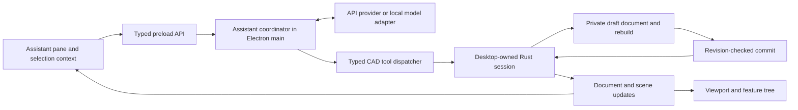

# Built-in AI assistant implementation plan

Status: deferred by owner decision, 2026-10-10, while completing
[Phase 2 CAD](phase-2-remaining-plan.md). Preserve the initial implementation and
offline regressions; live-model validation and connection debugging remain unresolved.
Resume feature/provider work only when the owner reactivates this track. The plan
below is retained for that future work. See [setup and implementation status](assistant.md)
for delivered behavior, verification and remaining validation.

Owner decisions: users talk to an assistant inside OpenForge while modeling.
Users can connect with an API key, use a local model, or authorize an eligible ChatGPT subscription (added by owner request). External MCP clients are
an optional integration, not the first AI experience to deliver.

## Product outcome

A user opens the assistant beside the viewport, selects geometry, and describes
an operation. The assistant understands the current part, asks for essential missing
dimensions, builds ordinary editable features, and reports what actually changed.
Users can continue with either normal CAD controls or conversation.

The first release should handle these examples using implemented CAD operations:

- “Make a 60 × 40 × 5 mm plate with four 6 mm through holes, 8 mm from each edge.”
- Select a face: “Put a 10 mm hole in the center of this face.”
- Select a feature: “Change this extrusion to 12 mm.”
- “Make short and tall configurations driven by a height variable.”
- “Explain why this feature failed,” followed by a proposed or requested repair.
- “Show me a preview with 2 mm fillets,” then “Use that version.”
- “Undo the last change.”

The plate example must produce sketches, constraints, dimensions and features that
remain editable. A rendered image or a mesh with no modeling history does not meet
the requirement. Unsupported CAD operations must be identified through the tool
catalog; the model cannot claim it implemented an unavailable feature.

## Initial implementation baseline

| Existing component | What it supplies | What is missing for the assistant |
| --- | --- | --- |
| `apps/desktop/src/main/core.ts` | Desktop-owned `openforge serve` process | Assistant coordination and document-change events |
| `crates/openforge/src/session.rs` | Authoritative document, feature operations, rebuild, revisions, undo | Multi-operation drafts, guarded commit and grouped undo |
| `crates/openforge/src/mcp.rs` | External tools forwarding to a Rust session | Live desktop attachment, detailed schemas and assistant orchestration |
| Renderer store/viewport | Selected refs, feature tree, visible configuration and preview rendering | Context capture and an assistant panel |
| Phase 2 foundations | Body IDs, equations, configurations and revision-checked single-feature preview | Assistant operations spanning several sketches/features |

The desktop starts `openforge serve`. `openforge mcp [part]` creates a separate
`Session`; it does not attach to the desktop's open document. They share core code,
not live state. Saving and reopening a shared file is not a live collaboration design.

The current tool schemas often describe nested arguments only as an object, with
examples in a long description. Feature build errors can appear inside successful
responses. There is no model provider, chat UI, agent loop or AI task transaction.
The current revisions guard previews, not all document mutations.

## User experience

Add a collapsible right-hand assistant pane, preserving the existing feature tree,
feature editor and viewport. On small windows, make the pane resizable or overlay it.
The composer accepts natural language and displays removable context chips for the
selected faces, edges, bodies or features and the active configuration.

Show concise progress such as “Creating hole sketch” or “Checking the rebuilt part,”
plus the actual result and changed feature names. Clicking a referenced feature or
geometry chip highlights it. Keep implementation logs out of the normal chat;
an expandable operation record is available for troubleshooting.

Use these interaction rules:

- Execute a clear, requested modeling change without confirming each individual
  sketch/feature operation. Group its completed operations into one undo entry.
- Honor requests to explain, plan or preview without changing the document.
- Ask about essential ambiguity, such as which of two faces is the target. Use
  highlighting and short choices. State any assumptions about optional dimensions.
- Offer Stop while working and Undo after a commit. Do not claim success until
  the core confirms the result.
- Keep a proposed preview separate from committed geometry. A later “use it” commits
  the specific valid proposal only if its source document is still current.
- During an open manual sketch/feature edit, support explanation and inspection.
  Initially defer AI mutations until that edit is finished; show the reason inline.
  Concurrent editing inside an unfinished manual sketch is a later capability.
- Save/export actions run when requested, using the existing destination workflow.
  Draft operations do not perform file writes.

## Architecture

The coordinator owns streaming, model calls, tool execution, cancellation and
bounded retries. The renderer owns chat presentation and context selection.
Provider credentials and network requests stay outside the renderer.

The Rust session remains the authority on dimensions, references, geometry and
document history. All clients use the same modeling operations. The assistant gets
an explicit tool catalog rather than arbitrary JSON-RPC method access, shell access
or generated-code execution. Keep model-provider dependencies out of the geometry,
sketch and model crates.

Introduce a document-change event path in the main process so changes initiated
by the assistant update the renderer just as manual changes do. Include a session
generation ID: a core restart must invalidate contexts even if its revision counter
starts over. A new/open document also invalidates pending work.

## API-key and local-model connections

Both connection modes are first-release requirements and use one normalized model
adapter interface: send context/tools, receive streamed text/tool requests, return
tool results, cancel, and report capability/authentication/availability errors.

| Mode | Setup | Expected behavior |
| --- | --- | --- |
| ChatGPT subscription | Browser sign-in, plan-use consent and discovered model | Uses the account’s eligible plan allowance through the public Responses API |
| API provider | Provider, API key and model | User supplies credentials; no OpenForge account or hosted relay is required |
| Local model | Local service endpoint and model | Connect to an already-running model service; work without an internet connection |

Select one concrete API provider and one concrete local backend for the initial
adapters before integration work begins. Check their documented tool-calling and
streaming contracts and run a small CAD task benchmark. The owner has selected
connection modes, not specific vendors or model names. Do not assume every server
with a similar HTTP API supports identical tool behavior.

The settings screen includes Test Connection, model selection and an actionable
error if the selected model cannot use the required tools. A model that supports
text alone may be offered as explanation-only; do not present it as able to model.
Use a normalized adapter boundary, but avoid promising arbitrary provider support.

Store cloud credentials in the operating system's credential facility. If secure
storage is unavailable, offer session-only credentials instead of plaintext storage.
Do not place credentials in `.ofp` files, chat records, the renderer or logs.
Explain during setup what part context will be sent to an API provider. Send the
selected, bounded context needed for the task; screenshots are optional context,
not an automatic upload of the full document.

Local mode makes no cloud-model calls and never silently falls back to a provider.
A nonlocal endpoint must be labeled as remote. Model downloading, bundled inference,
hardware tuning, billing and OpenForge accounts are outside the first release.
Expose per-task limits on steps, retries, elapsed time and tokens where the backend
supports them; report usage when available without inventing a cost estimate.

## Context and tool contracts

Capture context at request start: session generation, document identity/revision,
active configuration, rollback/edit state, units and selected stable references.
Include a concise feature/body summary and current errors. Query sketches, topology,
dimensions, dependencies and measurements on demand rather than sending every mesh
and feature payload with every message.

Names are labels; stable IDs and qualified refs identify geometry. Resolve selection
against the captured document. Ambiguous spatial language requires a geometric query
or user clarification. Camera orientation is context for phrases such as “on the
left”; it must not silently change model coordinates.

Generate or validate typed schemas from the Rust command definitions. Publish the
actual feature modes and capabilities available in the running build. Tool results
include operation status, stable created/changed IDs, resulting draft revision,
feature errors and relevant measurements. Distinguish an RPC transport success
from a successfully rebuilt feature. Use references between tool results rather
than guessing future feature IDs.

Start with a bounded tool set:

| Tools | Purpose |
| --- | --- |
| Inspect document, selection, feature, sketch and topology | Understand the user's part |
| Measure geometry and evaluate parameters | Check dimensions and derived results |
| Begin/discard draft | Stage a modeling task from a known document state |
| Create/edit sketch, add/edit supported feature | Build normal parametric history |
| Set equations and configuration overrides | Create controlled variants |
| Validate/preview draft | Surface rebuild errors and show proposed geometry |
| Commit draft | Apply a valid task as one undoable change |

Keep commit and file operations under coordinator control, tied to the user's
request mode. The model supplies modeling intent and tool arguments; model text
cannot grant itself broader execution permissions. Tool feedback, not prose alone,
determines the assistant's completion status.

## Draft, commit and undo behavior

1. Create a private draft from the captured live document. Draft edits use the same
   validators, solver and rebuild logic as manual modeling.
2. Stage all operations there. Intermediate sketches and failed attempts can be
   inspected or repaired without modifying the user's part or undo history.
3. At completion, validate the affected feature chain, resulting references and
   task-specific geometry checks. Report existing errors separately; introduce no
   new unhandled errors. A repair must demonstrably resolve its target error.
4. Commit only if session generation, document revision, configuration and editing
   context still match. Return the committed snapshot/scene and push one checkpoint.
5. If manual work changed the source document, discard the stale preview and refresh
   context. Never silently replay an old plan against different geometry.

Proposed protocol additions are `draft.begin`, `draft.apply`, `draft.inspect`,
`draft.preview`, `draft.commit` and `draft.discard`; exact payloads belong in the
protocol implementation PR. Each draft has an opaque ID, base identity/revision,
local revision and lifetime limit. References created within a draft remain valid
when its exact document is committed. A commit token makes repeated delivery
idempotent, so reconnect/retry cannot duplicate features or undo entries.

Draft operations exclude new/open/save/export and global undo/redo. Undoing an AI
change uses the normal committed document history. Manual edits while the model is
thinking remain allowed; they invalidate a conflicting commit instead of being
held behind a network request.

Stop cancels model/network work immediately and prevents later commit. Native
kernel calls currently run synchronously: check cancellation between operations and
discard a completed result if cancellation arrived meanwhile. Do not promise to
interrupt a running kernel call instantly. Benchmark responsiveness and, if needed,
run draft geometry in a disposable worker while keeping final commit in the live
session. Never stop the user's core process to cancel an AI task.

## Implementation sequence

| Milestone | Work | Acceptance gate |
| --- | --- | --- |
| AI.0 — Draft transactions | Session identity, typed tool contracts, draft lifecycle, idempotent commit and grouped undo | A scripted multi-feature task commits once; failure/cancel/stale state leaves the live part unchanged |
| AI.1 — Assistant UI and context | Right pane, selection chips, request modes, progress, highlight links, Stop/Undo and document events; deterministic fake adapter | A fake tool sequence updates the same live viewport/tree and one Undo restores the original part |
| AI.2 — Model adapters | Choose and implement the initial API-key and local-service adapters; settings, capability test and streaming | Identical tool fixtures work with both modes; local mode runs with external network access disabled |
| AI.3 — Modeling loop | Bounded inspect/build/validate/repair loop with typed tool results and context retrieval | Plate, selected-face hole and selected-feature edit work and persist as editable feature history |
| AI.4 — Variants and hardening | Equation/configuration workflows, explanation/repair, persistence, failures, regression corpus and documentation | Variants have expected dimensions; retries, cancellation, errors and stale refs pass the tests below |

AI.0 is the first implementation unit. It is useful without a model provider and
must land before permitting AI-generated document mutations. Prototype provider
behavior against recorded/fake tools while the transaction contract is developed.

Use currently implemented Phase 1/2 CAD features in AI acceptance tasks. This plan
does not mark Phase 2 complete or silently add the entire AI track to its release
criteria. Retain the existing MCP endpoint; defer live desktop MCP attachment until
the built-in assistant is working and can share the same context/transaction tools.

## Repository integration

- `crates/openforge/src/session.rs`: live document authority and guarded commit;
  extract draft/tool-contract modules to keep session routing manageable.
- `crates/of-model`: reusable document cloning, evaluation, rebuild and validation;
  keep provider and chat concepts out of this crate.
- `crates/of-protocol` and `docs/protocol.md`: typed operation results, session
  identity, draft messages, change events and compatibility/version policy.
- `apps/desktop/src/main/assistant/`: coordinator, adapters, credential access,
  capability checks and task records.
- `apps/desktop/src/main/core.ts` and main IPC handlers: tool routing and document
  update delivery for the existing core process.
- `apps/desktop/src/preload/{index.ts,api.d.ts}`: narrow typed assistant calls/events.
- Renderer assistant components/store and `App.tsx`: chat/context UI; existing
  viewport/store receive authoritative document and preview changes.
- Rust integration tests and desktop smoke: deterministic task fixtures and checks
  for selection, typing focus, feature editing, cancellation and undo.

Keep chat/task history separate from the geometry document. In the first iteration,
keep conversations session-local; save useful operation diagnostics only through an
explicit user action. Persisting/reopening chat history is a later decision and must
not replay operations automatically.

## Verification and completion criteria

Deterministic tests run without paid model calls. Record schema-valid and invalid
tool sequences to exercise drafts, dependency failures, provider errors, tool limits,
stop races, repeated commits, core restarts and manual edits during model latency.
Test that text entry in chat does not trigger CAD keyboard shortcuts.

Verify geometry and history, not just assistant replies: plate/hole volume and
positions, expected dimensions, valid solids, correct body/configuration scope,
retained downstream references, one-step undo/redo and `.ofp` save/reopen.
Inspect preview-only requests for zero live mutations. Ensure failed tasks do not
leave partially applied sketches, consume live IDs or add undo checkpoints.

Run a separate repeatable live-model benchmark for the selected cloud and local
models. Record task completion, clarification accuracy, valid geometry, tool failures,
latency and usage where available. Pin the tested model identifiers/settings and
publish limitations. Tool-contract conformance alone does not establish modeling
quality. Set release thresholds after the initial benchmark provides a baseline.

The built-in assistant is complete only when both connection modes work, it acts on
the desktop's live document, supported tasks create editable geometry, cancellation
and grouped undo are reliable, and the repository checks plus native smoke pass.
Calling the existing MCP endpoint or adding a chat panel alone does not satisfy this
plan.
